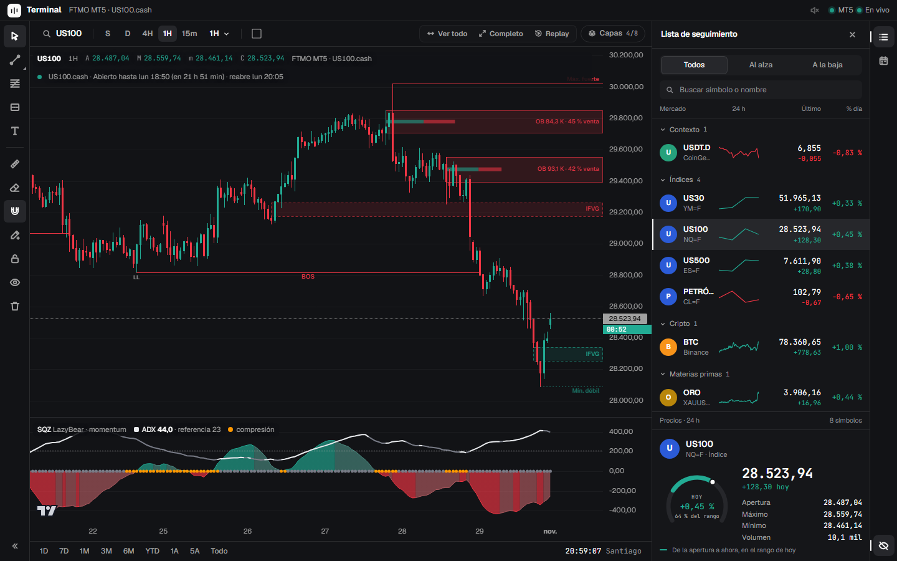

# Terminal Cripto

Terminal de trading que corre en tu PC: gráficos en vivo con **ADX, squeeze y perfil de
volumen**, y operativa en MetaTrader 5 y Binance, con replay, créditos demo, freno de
disciplina y cabina de riesgo para cuentas de fondeo. Cada orden la confirma la persona.



> **Aviso.** Esto no es asesoría financiera ni una recomendación de inversión, y el trading
> puede hacerte perder dinero. Con la operativa encendida, la terminal envía órdenes reales:
> úsala bajo tu responsabilidad, pruébala primero en una cuenta demo y revisa que las reglas
> de tu broker o firma de fondeo permitan este tipo de herramientas.

| Mercado | Datos |
|---|---|
| **USDT.D** | Reconstruida con CoinGecko (ver abajo) |
| **BTC** | Binance spot |
| **US30, US100, US500, petróleo** | Los CFD del broker por MT5 (FTMO: `US30.cash`…, `USOIL.cash`), en vivo; sin MT5, los futuros de CME en Yahoo Finance (YM=F, NQ=F, ES=F, CL=F) |
| **Oro** | El perpetuo XAUUSDT de Binance |
| **USD/CLP** | Yahoo Finance (`CLP=X`), con unos minutos de retraso |

## Uso

Necesita **Node 23.6 o más nuevo** (corre TypeScript directo, sin compilar).

```bash
git clone https://github.com/maudevdigital/terminal-cripto.git
cd terminal-cripto
npm install      # la primera vez: backend e interfaz
npm run build    # arma la interfaz (npm start lo hace solo)
npm run dev      # servidor con recarga al guardar: abre MT5 y el navegador
npm start        # lo mismo, sin recarga
```

Queda en <http://127.0.0.1:8787>. Al arrancar abre **MetaTrader 5 con el puente**
(ver abajo) y el navegador; con `npm run dev` el navegador se abre una sola vez: en
cada recarga la pestaña que ya estaba se reconecta sola.

**Sin configurar nada sirve para mirar:** gráficos e indicadores con datos públicos y la
operativa apagada. El repositorio no trae credenciales. Para sumar tu cuenta, copia
`.env.example` a `.env` y completa lo que uses (MT5, Binance, Google Sheets); `.env` y
`datos/` nunca se suben. Para operar hay que encender a propósito `TRADING_ACTIVO` (MT5)
o `BINANCE_TRADING` (Binance).

## Aspecto

El gráfico manda. Grises neutros, bordes casi invisibles, sin color de acento y la
fuente Geist (números en JetBrains Mono). La interfaz nueva se escribe con
**Tailwind CSS** (v4, sin su reset, con la paleta de `:root` como colores:
`bg-panel`, `text-tenue`…, y la variante `movil:` para el celular). Lo simple va con
utilidades en el JSX (cabecera, rail, lista, selector de temporalidad, barra de
abajo); lo de antes (Operar, historial, calendario, replay, dibujos…) está en
`web/src/estilos/*.css` con `@apply`, uno por parte y en el orden de la cascada
(`web/src/tailwind.css` los importa). La paleta está en `estilos/base.css`.

- **Rail** a la derecha, una estación por vez: **Lista de seguimiento** (Shift+L),
  **Operar** (Shift+O; cuenta las posiciones abiertas y marca en rojo si el freno está
  puesto), **Créditos demo** (Shift+D), **Calendario** (Shift+C; punto rojo si viene
  una noticia restringida), **Historial** (Shift+H) y, abajo, el **modo presentación**
  (Shift+P). Cada estación tiene su encabezado con ✕.
- **Al abrir**: 1H, con semanal, diario, 4H, 1H y 15m fijadas, y a la vista estructura,
  order blocks, IFVG, ADX + SQZ y las operaciones. Lo demás está en **Capas**. La
  preferencia se cambió una vez; después manda lo que elijas.
- **Buscador de mercados**: la lupa junto al nombre del mercado, o
  escribir una letra sobre el gráfico. Pestañas por tipo, ↑↓ para moverse, Enter abre el
  gráfico, Tab cambia de pestaña y Esc cierra; a la derecha, la ficha del marcado
  (precio, cambio de hoy, 24 h y la rueda de hoy).
- **Atajos** (como en TradingView): una letra abre el buscador y un número la
  temporalidad; las secciones van con Shift y los dibujos con Alt: **Alt+T** línea de
  tendencia, **Alt+H** horizontal, **Alt+V** vertical, **Alt+C** cruzada, **Alt+R**
  rectángulo, Esc el cursor.
  Pasando el mouse por un botón aparece su nombre con su atajo.
- **Varios gráficos**: el botón de diseño, junto a la temporalidad, reparte
  la pantalla en 1, 2 (lado a lado o uno arriba del otro), 3, 4 (2 × 2) o 6 (3 × 2)
  gráficos. Cada uno con su mercado y su temporalidad, en vivo; el **activo** (el último
  tocado, con borde) recibe los atajos: una letra abre el buscador para él, un número su
  temporalidad, Alt + tecla sus dibujos. La barra de dibujo es una sola, a la izquierda
  de la grilla: la herramienta va al gráfico activo; el imán, el bloqueo, seguir
  dibujando y ocultar valen para todos. El principal es el primero (Operar, el replay,
  los sonidos y los rangos de abajo van con él).
- **Órdenes desde el gráfico**: el **+** junto al eje de precios sigue al
  cursor y arma una orden límite a ese precio en Operar (debajo del precio, una compra;
  arriba, una venta). Las líneas de la orden que se está armando (el precio límite, el SL
  y el TP) se **arrastran**: al soltar, el precio va al formulario. Nada se manda sin la
  confirmación del panel.
- **Etiquetas de las operaciones**: pegadas al precio del eje, sin tapar
  las velas: [Largo/Corto · volumen · resultado · ✕] en lo abierto, [SL/TP · resultado]
  en sus niveles y [Compra límite · volumen · ✕] en las pendientes. La **✕ cierra la
  posición a mercado de una** (o cancela la orden), sin confirmación; el resultado se
  avisa arriba al centro. En Binance, igual.
- **Zoom suave**: la rueda desliza el zoom hacia cada muesca en vez de saltar (siguiendo
  la última vela queda fijo el borde derecho; si no, la vela bajo el mouse). Volver al
  precio, los rangos rápidos y el cambio de mercado o temporalidad también se deslizan.
- **Lista de seguimiento**: los mercados agrupados (contexto, índices, cripto, materias
  primas) con su minigráfica de 24 h, y la ficha del elegido: precio, cambio de hoy,
  dónde está dentro del rango del día y la rueda de hoy. En la compu reemplaza a los
  mercados de la cabecera; en el celular siguen arriba.
- **Temporalidades**: escribe un número sobre el gráfico (5, 15, 30, 4h,
  d…) y Enter; el menú las agrupa en minutos, horas y días. **Cualquier temporalidad**
  se puede escribir (3m, 10m, 45m, 2h, 12h, 2d, 2s…): el servidor la arma en vivo con la
  de siempre más grande que entra justo (`src/temporalidades.ts`: 3m con 1m, 10m con
  5m, 2H con 1H, 12H con 4H, 2D con D). **Shift+Enter** la grafica y la **fija** en la
  barra; la estrella de cada una la fija o la saca, y la ✕ de un botón fijo lo quita.
  Las fijas a medida quedan en "Personalizadas" del menú.
- **Barra de abajo**: rangos rápidos (1D, 7D, 1M, 3M, 6M, YTD, 1A, 5A, Todo; cada uno
  con su temporalidad) y la hora local.
- **Capas** en un menú; el OHLC en la leyenda. Si falta ancho, los botones de la barra quedan solo con su ícono.

## Replay y backtest (US100)

El botón **Replay** del gráfico (solo en US100; `REPLAY_SIMBOLO` lo cambia) vuelve atrás en el
tiempo con las velas de FTMO: se elige la vela con un click en el gráfico, o una
fecha y hora (de Chile), y desde ahí se avanza vela a vela (→), se reproduce
(espacio) a 0,5–10 velas por segundo o se salta a otro punto. Cada temporalidad
muestra su vela en curso a medio formar, con el squeeze, el ADX y las medias de ese
momento. 1m llega hasta donde llega la historia de 1 minuto (unos 3 meses; antes,
un aviso dice desde cuándo hay); 5m y 15m, 1,4 años (con las velas de 5 minutos), y
1H, 4H y diario, años. Al llegar al borde izquierdo suma más velas. **Salir** vuelve
al precio en vivo.

Durante el replay, el panel **Backtest** reemplaza a Operar (nada va a la cuenta):

- **Operaciones simuladas**: compra o venta, límite o a mercado, con SL y TP; los
  lotes salen del balance y el riesgo elegidos (el del plan por defecto). Se llenan
  y cierran con las velas de 1 minuto que van saliendo (si una vela toca el SL y el
  TP, cuenta el SL; sin spread ni comisiones). Se puede mover el SL a BE o cerrar a mercado. Quedan guardadas en
  `datos/backtest.json`, con el resumen de este replay o de todas: acierto, R,
  dólares, factor de ganancia y caída máxima.

## Freno de disciplina

Al perder **30 USD** en el día de la firma (lo cerrado y lo flotante de la cuenta de
FTMO), la terminal no deja abrir nada nuevo, ni en MT5 ni en Binance, hasta que corta
el día (medianoche de `PROP_ZONA`: las 19:00 o las 20:00 de Chile, según el horario
de verano de cada lado).
Cerrar, mover el SL o el TP y cancelar siguen permitidos. Se ve en Operar. Se ajusta
en el `.env`: `FRENO_PERDIDA_DIA_USD`; también puede frenar por % del balance
(`FRENO_PERDIDA_DIA_PCT`, si no hay tope en USD), por pérdidas seguidas
(`FRENO_PERDIDAS`, apagada) o por operaciones en el día (`FRENO_OPERACIONES`, 2 por
defecto); y `FRENO_MODO` (`bloquear` o `avisar`).

**El freno en MT5** (`FRENO_MT5`). Con el freno bloqueando, lo que se pone por fuera
de la terminal (directo en MT5 o en el celular) también se frena: con `cancelar`, las
órdenes límite o stop nuevas se cancelan; con `avisar`, solo queda el aviso en el registro.
**Las posiciones nunca se cierran solas.** Lo que ya estaba abierto o puesto cuando el freno se
activó no se toca, tampoco una de esas límite si se ejecuta después. Lo que se abre con
la terminal apagada, el PC dormido o MT5 desconectado se toma como ya puesto. Necesita la terminal abierta, el Operador
encendido y el mercado abierto (si está cerrado, reintenta al abrir). `no` lo apaga.

**Pausa después de salir** (`FRENO_PAUSA_MIN`, en minutos). Después de cualquier salida,
también con ganancia, no se abre nada nuevo durante ese rato. Se cuenta desde que la
posición desaparece de MT5.

**El SL inicial es el techo** (`FRENO_SL_INICIAL`). El primer SL que se le ve a una
posición abierta marca su riesgo máximo: se puede acercar, pero no alejar ni quitar. Desde
la terminal se rechaza antes de mandarlo. Si se amplía directo en MT5, la terminal lo
devuelve al inicial; si el precio ya lo pasó, no lo toca. Mientras una orden está pendiente, su SL se puede mover libre.
Necesita la terminal abierta, el Operador encendido y el mercado abierto.

**Pausar la cuenta real.** El botón **Pausar cuenta real**, en Operar y en Créditos demo,
frena toda apertura real, también en Binance, hasta que la quites; con `FRENO_MT5` frena
además lo que se abra directo en MT5. Lo que ya estaba abierto no se toca, y cerrar sigue
permitido. Ponerla es inmediato; quitarla tarda `FRENO_PAUSA_SALIR_MIN` minutos (10), para
que no se pueda saltar en un impulso, y mientras tanto se puede volver atrás. Ojo: FTMO
puede terminar una cuenta con 30 días corridos sin operar (cláusula 13.2.3).

**Corte automático.** Si una posición queda **sin stop loss** (en MT5 o en Binance),
la terminal le pone uno de verdad en el broker, en el precio donde esa posición
pierde **30 USD** (`CORTE_AUTO_USD`; 0 lo apaga). Si ya perdió eso, o el precio ya
pasó ese nivel, no la toca: la terminal nunca cierra sola. Lo que tiene SL no se toca,
y si después le quitas el SL, vuelve a ponerlo. Como el SL queda en el broker, corta
aunque la terminal se apague; pero ponerlo requiere la terminal abierta, el operador
de MT5 encendido (o `BINANCE_TRADING` en Binance) y el mercado abierto. Es por
posición: no mira lo que ya se perdió en el día. Revisa también lo que se abre
directo en MT5.

**Sonidos.** La terminal suena cuando se ejecuta una orden (a mercado o una límite que
se llena), cuando toca el **SL** o el **TP**, al cerrar a mano o en parte, al mover el SL o
el TP y al poner o cancelar una pendiente; cada uno con su tono, en MT5 y en Binance.
El motivo de un cierre en MT5 sale del historial (el deal dice si fue el SL o el TP);
en Binance se deduce del último precio. Suenan los de **NinjaTrader** (`OrderFilled`,
`StopFilled`, `TargetFilled`, `PositionClosed`, `OrderPending`, `OrderCanceled`): la
terminal los toma de donde los instala NinjaTrader 8, de la carpeta `sonidos/` o de
`SONIDOS_CARPETA` (ver `sonidos/LEEME.md`; no van al repo). El que falte suena con un
tono propio. El parlante de la cabecera los apaga. El
navegador no deja sonar hasta el primer clic o tecla en la página.

## Créditos demo

La estación **Créditos demo** del rail (Shift+D, `src/demo.ts`): una cuenta virtual para
practicar con los precios de MT5. Tiene su propia ruta en el servidor (`/api/demo`), se
guarda en `datos/demo.json` y **nada de eso pasa por el Operador**: no puede tocar la
cuenta real. Tampoco va al historial.

- **Al empezar** se elige: igual a tu cuenta de FTMO (el mismo balance y el mismo límite) o
  una nueva de 10.000.
- **Las reglas son las de la evaluación**: pérdida diaria y total sobre el equity (PROP_*).
  Si se toca una, se cierra todo y la cuenta queda perdida hasta recargar.
- **Se opera igual**: compra o venta, a mercado (al ask o al bid) o límite, con SL
  obligatorio. El riesgo vacío usa el del plan, y los lotes salen de ahí. Las líneas de lo
  que se arma se arrastran en el gráfico y el **+** del eje llena este formulario si la
  estación está abierta. Lo abierto se ve sobre las velas como *Demo*; el SL y el TP se
  cambian en el panel. Sin comisiones ni swap: el costo es el spread, y el SL se llena al
  precio que haya en ese momento. Corre mientras la terminal y MT5 están abiertos.
- **No bloquea, mide**: reentradas a menos de 5 minutos, SL ampliados, BE antes de +1 R,
  cierres a mano y días con una sola operación. Y cada operación se sigue también **sin
  tocar**, con su SL y su TP originales (hasta 14 días): así se ve cuánto cuesta, o cuánto
  salva, moverlos o salirse antes.

## El gráfico

Temporalidades: mensual, semanal, diario, 4H, 1H, 30m, 15m, 5m y 1m (30m sale de Binance
y Yahoo; en MT5 se arma con las de 15 minutos mientras el puente no exporte M30:
el puente nuevo ya lo trae en `InpVelasTF`). El eje va en la hora
local; arriba del precio, la cuenta regresiva del cierre de la vela. Se arrastra
con inercia y los precios van en formato chileno (29.154,05).

**Más historia al ir hacia atrás**: al llegar al borde izquierdo, el gráfico pide
las velas anteriores y las suma sin mover la vista (con las medias y el ADX
recalculados con toda la serie). En el US100 sale de la historia de FTMO que el
puente exporta a pedido, armada con las velas de 1 minuto que MT5 ya tiene en el
disco: 1m unos 3 meses (el tope de "Máximo de barras en el gráfico" de MT5), 5m y
15m 1,4 años, 1H, 4H y diario unos 5. El servidor la pide de a dos temporalidades
y solo con MT5 conectado.

Colores (paleta desk, en `web/src/lib/constants.js` para el gráfico y en `:root` de
`web/src/styles.css` para la interfaz, con `--rgb-*` para las transparencias): fondo
casi negro `#0E0F12`, superficies `#14151A`/`#1A1C22`, bordes `#2A2D36`, texto
`#E8EAED`, velas verde `#26A69A` y roja `#EF5350`, acento dorado `#C4A574`.

Capas que se prenden y apagan:

- **Sesiones**: Sídney (07:00–16:00), Tokio (09:00–18:00), Londres (08:00–17:00) y Nueva York (09:30–16:00), cada una en la hora de su ciudad: una caja con su máximo y su mínimo, sin líneas. Hasta 1H.
- **FVG**: los Fair Value Gaps de la temporalidad del gráfico, por debajo de las
  velas, solo los que el precio no barrió: si una vela cierra al otro lado del hueco,
  se invierte (**IFVG**: color contrario y borde punteado) hasta que una mecha lo
  atraviesa de vuelta; si solo la mecha lo atraviesa, desaparece. Quedan los 8 FVG y los 4 IFVG más recientes; con la capa prendida, los
  botones **FVG** e **IFVG** muestran cada tipo por separado (al empezar, solo IFVG). Los mismos del
  indicador de TradingView.
- **Estructura** (`src/smc.ts`), en dos
  niveles: **swing** (giros de 50 velas, siempre) e **interna** (5). Los
  giros alternan siempre (un máximo, un mínimo) y se nombran HH/HL/LH/LL; con un doble
  techo el giro es el segundo. Una vela que **cierra** más allá del último giro sin romper
  es **BOS** a favor de la tendencia y **CHoCH** contra ella (la swing en línea llena, la
  interna punteada; una interna en el mismo nivel que la swing no se cuenta dos veces).
  El máximo y el mínimo del tramo swing van hasta el borde: **fuerte** el que defiende la
  tendencia (el máximo en bajista), **débil** el otro (el objetivo). Botones *Swing* e
  *Interna* (la interna arranca apagada).
- **Order blocks** (`src/orderBlocks.ts`):
  giros de 5 velas; una vela que **cierra** más allá del último giro sin romper crea el
  OB en la vela del extremo opuesto entre el giro y la ruptura (en el alcista, la del
  mínimo más bajo), solo si el impulso trajo al menos **1,2 veces el volumen promedio**
  de las 20 velas anteriores. Adentro, una barra con su volumen (el de su vela y las dos
  siguientes), la parte comprada en verde y la vendida en rojo, y la etiqueta con el
  total y el % (`OB 7,1 K · 69 % compra`: la parte del lado que lo armó, no una
  probabilidad). Se borra cuando una vela cierra al otro lado; si el precio ya volvió a
  entrar, se ve más tenue. Quedan los 3 alcistas y 3 bajistas más cercanos al precio.
  (Los OB que calcula la estructura SMC, `src/smc.ts`, no se dibujan.)
- **Medias**: EMA 10, 50 y 200 (apagadas al empezar).

- **Volumen**: **VPVR** (perfil del rango visible, a la derecha) y **VPSV** (uno por
  sesión), cada uno con su POC; se prenden por separado y se pueden ver juntos. Con
  **POC ⟶** el POC de cada sesión se extiende a la derecha hasta la primera vela que
  lo toca (punteado); los que nadie tocó (POC vírgenes) llegan al borde con su precio
  en el eje. Como
  en TradingView: 24 filas (`VP_FILAS`) y área de valor del 70 %. El volumen de cada
  vela se reparte entre los precios que cubrió (TradingView usa además velas de una
  temporalidad menor, así que el perfil puede diferir un poco del suyo).

- **Posiciones**: las abiertas en MT5 del mercado en pantalla (entrada, stop y
  objetivo), pasadas al precio del gráfico con la diferencia del broker; la etiqueta
  muestra el precio del broker. Apagala para grabar o compartir la pantalla.

**Ver todo** muestra toda la historia cargada y **Completo** (Shift+F, sale con
Escape) saca el panel de la derecha y pone el navegador a pantalla completa.

Abajo, en el mismo gráfico:

- **Squeeze**: momento del squeeze (área de cuatro tonos: fuerte mientras acelera y pálido cuando pierde fuerza), compresión (puntos) y el **ADX**, todo en
  **una sola escala**: al mover el eje Y se mueven juntos. Para eso el ADX se pasa a las unidades del
  SQZ (un ADX de 50 queda a la altura de lo que suele moverse el SQZ; el eje no marca el ADX), con la
  línea punteada del nivel clave (`ADX_CLAVE`, 23): arriba hay tendencia. La leyenda
  muestra su valor en la vela bajo el puntero. Se prende y se apaga con la capa
  **ADX + SQZ**, como las demás; apagada, las velas toman su lugar.

**Alt+I** da vuelta la escala del precio, como en TradingView (el gráfico se ve de
cabeza; los dibujos y las operaciones siguen en su precio). La leyenda lo avisa y se
recuerda; otra vez Alt+I lo vuelve.

**Los indicadores dan lo mismo que TradingView, salvo la compresión del SQZ (abajo).** Están calculados con las
fórmulas de Pine, incluido cómo arranca cada uno, y las pruebas los comparan vela por
vela con el código de TradingView:

- **EMA** (`ta.ema`): arranca en el primer cierre, así que la EMA 200 tiene valor
  aunque haya menos de 200 velas (el mensual de BTC tiene ~110).
- **Squeeze Momentum [LazyBear]** (20, 2,0, 20, 1,5, true): las Bandas de Bollinger usan
  su propio multiplicador (2,0), la corrección que indicó su autor. El script que muestra
  TradingView todavía usa 1,5 para las dos, así que ahí hay más puntos de compresión: en
  US100 1H, 44 % de las velas contra 20 % aquí. El histograma no cambia.
  `SQZ_BB_MULT=1.5` deja los puntos como en TradingView.
- **ADX** (el *Directional Movement Index*, 14 y 14): el true range de la primera
  vela es `na`, el suavizado de Wilder arranca con el promedio de la primera ventana
  completa y una división por cero repite el último valor (`fixnan`).
- **Historia**: 1.500 velas por temporalidad; la EMA 200 necesita unas 1.400 para
  olvidar su arranque. Semanal y mensual cargan toda la historia de Binance, la
  misma desde la que calcula TradingView.

## USDT.D

Binance no la publica y la historia del total de mercado en CoinGecko es de pago,
así que se reconstruye gratis: capitalización de USDT sobre la suma de las 10
mayores monedas (más del 90 % del mercado), escalada al total actual. Comparada
con `CRYPTOCAP:USDT.D` de TradingView, los cambios hora a hora coinciden en 0,99 y
queda del mismo lado de la EMA 50 el 92 % de las horas; el nivel queda unas
centésimas abajo. La historia se guarda en `datos/usdtd.json`: al reiniciar no se
vuelve a pedir, y después alcanza con una consulta cada 3 minutos. El plan
gratuito de CoinGecko limita las llamadas; con una clave "demo" gratuita
(`COINGECKO_API_KEY`) carga mucho más rápido.

## Oro

Sale del perpetuo TradFi de Binance (XAUUSDT). Otros perpetuos de la misma familia
se agregan con `PERPETUOS` en el `.env`.

## USD/CLP

De Yahoo Finance (`CLP=X`), con unos minutos de retraso. Otras divisas se agregan en
`INDICES` con su código de Yahoo (por ejemplo `USDARS:ARS=X`).

## Índices y petróleo: US30, US100, US500, USOIL

Con MT5 abierto salen del **broker**: las velas de los CFD (`US30.cash`,
`US100.cash`, `US500.cash` en FTMO) que exporta el puente, en vivo y con el precio
con el que se opera. La leyenda dice "FTMO MT5 · US100.cash". Las diarias, semanales
y mensuales se anclan a la fecha de su rueda (de 17:00 a 17:00 de Nueva York, como
el futuro) y las intradía pasan a UTC con el horario del servidor.

Sin MT5 salen de Yahoo Finance, gratis y sin clave: los futuros de CME del Dow
(YM=F), el Nasdaq 100 (NQ=F) y el S&P 500 (ES=F), que cotizan casi 24 horas como los
CFD. El futuro lleva una prima sobre el índice contado que se achica hasta el
vencimiento, así que los niveles quedan corridos unos puntos respecto del CFD; el
dibujo es el mismo. **Yahoo entrega los futuros con unos 10 minutos de retraso**;
la leyenda muestra la hora del último dato. Para usar otro símbolo de Yahoo (por
ejemplo el contado, `^GSPC`): `INDICES=US500:^GSPC,...`. La historia se pide por
temporalidad (el 4H se arma con velas de 1H) y se refresca cada 5 minutos; en vivo
se leen velas de 1m cada 15 segundos.

## MetaTrader 5

De solo lectura: el EA `mt5/CriptoTerminalBridge.mq5` no manda ni modifica
órdenes. Al arrancar, la terminal:

1. Busca la instalación de MT5 (la que ya tiene el puente; o `MT5_TERMINAL` en el
   `.env` si hay más de una).
2. Copia el puente a `MQL5\Experts\CriptoTerminal` y lo compila con MetaEditor si
   cambió (guarda una copia del anterior).
3. Si MT5 está cerrado, lo abre. Si el perfil no tiene el puente en ningún gráfico,
   lo abre con un gráfico de XAUUSD H1 con el puente puesto; MT5 lo guarda en el
   perfil al cerrar, así que eso pasa una sola vez. Si hay dos puentes, el segundo
   se retira solo.

El puente escribe cada segundo en `MQL5\Files\cripto-terminal\estado.json` la
cuenta, las posiciones, la cotización de cada símbolo y las dos últimas velas de
cada temporalidad, y en `cripto-terminal\velas\` la historia (M1 a MN1, hasta 1000
velas de lo que MT5 ya tiene: nunca le pide bajar años de historia). Los símbolos
van en `InpSimbolos` (por defecto BTCUSD, XAUUSD, XAGUSD y los tres índices) y se
cruzan con los de la terminal con `MT5_SYMBOL_MAP`.

Con eso la terminal grafica los índices con las velas del broker, muestra en el
panel y en la leyenda la cotización del broker y su diferencia con el gráfico, y
dibuja las posiciones. MT5 no recarga un EA que se recompila mientras corre: si el
panel avisa que el puente es una versión anterior, reiniciá MT5.

`MT5_LANZAR=false` (o `--sin-mt5`) no lo abre; `MT5_VELAS=false` deja los índices
en Yahoo. Ver `mt5/LEEME.md` para instalarlo a mano.

## Operar desde la terminal

El panel de la derecha, **Operar**, manda órdenes a tu cuenta de MT5, también la
real de FTMO. De arriba hacia abajo: lo que falta para poder operar (si falta algo),
la **cuenta** (balance, equity, flotante, margen libre y la cabina de riesgo), el
**freno**, las **operaciones abiertas** de todos los mercados con su total (y un
botón para llevar el gráfico a cada mercado), las órdenes pendientes, tu cuenta de
**Binance** y, al final, la **orden nueva**.

**Binance (futuros USDⓈ-M)**: con `BINANCE_API_KEY` y `BINANCE_API_SECRET` en el
`.env`, Operar muestra el saldo, el equity, lo no realizado y lo disponible, y cada
posición con su entrada, precio de marca, apalancamiento, SL, TP y liquidación (en el
gráfico de ese mercado también, donde el SL y el TP se **arrastran** como los de MT5:
al soltar, se confirma). Cada posición y cada límite que espera tienen
**SL / TP** (mover, poner o quitar: primero se pone el nuevo y después se quita el
viejo, así nunca queda sin SL por un error) y **Cerrar** (a mercado, toda) o
**Cancelar**. Con el gráfico en un mercado de Binance, la orden nueva tiene el
selector **FTMO · MT5 | Binance**: a mercado o límite, por cantidad o por riesgo en
USDT (con el SL), con SL y TP que cierran toda la posición (por precio de marca),
y el resumen de nocional, margen, lo que se pierde en el SL y se gana en el TP.
Todo se revisa y se confirma; el servidor valida de nuevo (cantidad y precios al
paso de Binance, el mínimo del mercado, el lado del SL y del TP, el SL obligatorio
con `BINANCE_SL_OBLIGATORIO`) y el freno de disciplina también frena las aperturas
de Binance. Viene solo para mirar: `BINANCE_TRADING=true` la habilita. La clave necesita
permiso de futuros, SIN retiros y con tu IP habilitada; si tu IP cambia, Binance la
rechaza y Operar lo avisa.

La **orden nueva**:

- **Abrir** a mercado o con **orden límite**, comprando o vendiendo, con **SL y TP**
  en precio o en pips. Para cada uno muestra los pips, cuánto representa en USD con
  el volumen elegido, la relación riesgo/beneficio, el % del equity en riesgo y el
  margen. El volumen se escribe en lotes o sale del riesgo en USD con el SL.
- **Spread**: el del broker en precio, pips y USD por lote, y de qué lado pesa más
  respecto del precio del gráfico: comprar paga el ask y vender el bid, y si FTMO
  cotiza corrido de Binance, un lado sale más caro que el otro.
- **Posiciones y órdenes pendientes** de la cuenta (también las de otros mercados):
  cerrar (total o parcial), cancelar y **modificar**. Con **SL / TP** se escriben el
  stop y el objetivo nuevos (en una pendiente, también su precio) y al lado se ve,
  mientras se escribe, cuántos pips quedan desde la entrada y cuánto da en USD si
  toca; en el gráfico se dibuja cómo quedaría. Atajos: *SL a la entrada*, *Sin TP*
  y *Como estaba*.
- En el **gráfico** se ven las posiciones (entrada, SL y TP con lo que dan en USD),
  las órdenes pendientes (punteadas) y la orden que se está armando, con sus zonas
  de riesgo y de ganancia. Las líneas cruzan todo el gráfico con su texto a la
  derecha, junto a su precio en una marca sobre el eje (sin rayas: si dos marcas
  chocan, una se corre lo justo); un triángulo marca la vela en que se abrió cada
  posición. Van arriba de todo, también de los dibujos, y sus etiquetas se ubican
  primero, así quedan justo en su precio. Ninguna etiqueta
  empieza debajo de la barra de dibujo; con el perfil de volumen,
  las de la derecha van a su izquierda, sin taparlo.
- **Arrastrar en el gráfico**, como en MT5: el SL y el TP se mueven tomando su
  línea (el cursor cambia al pasar cerca); la línea de entrada, arrastrada hacia la
  pérdida, pone el SL, y hacia la ganancia, el TP; en una pendiente se mueve también
  su precio. Mientras se arrastra se ve el precio nuevo, los pips y el USD; al
  soltar aparece la confirmación con el antes y el después. Nada sale para MT5 sin
  **Confirmar**; Escape o Cancelar lo dejan como estaba.

Cada orden se revisa y se confirma en el panel, y la ejecuta el EA
`mt5/CriptoTerminalOperador.mq5`, que la valida de nuevo: solo opera la cuenta que
tenga en `InpCuenta`, descarta órdenes de más de 15 segundos (si la terminal se
cuelga no quedan órdenes viejas), ejecuta cada una una sola vez, respeta el volumen
mínimo, máximo y paso del símbolo y `InpLoteMax`, controla el lado del SL y del TP
y, con `InpSlObligatorio` (prendido por defecto), no abre sin stop. El puente sigue
siendo de solo lectura.

Para habilitarlo, una vez: la terminal instala y compila el Operador; en MT5
arrastrá **CriptoTerminalOperador** (Navegador › Asesores › CriptoTerminal) a
cualquier gráfico, poné tu login en **InpCuenta**, tildá *Permitir trading
algorítmico* y activá **Algo Trading**. El panel muestra qué falta.
La operativa viene apagada: `TRADING_ACTIVO=true` la enciende.

### Horario del mercado

Con el mercado cerrado (la pausa diaria de los índices, el fin de semana) MT5 no
deja abrir, cerrar, cancelar ni modificar nada: una orden pendiente que no se
canceló antes del cierre **sigue viva** y puede ejecutarse al reabrir. Por eso la
terminal muestra el horario real de cada símbolo, con las sesiones de trading que
exporta el puente:

- En la leyenda del gráfico y arriba de Operar: *Abierto hasta 18:00*, en ámbar
  *Cierra 18:00 (en 12 min)* desde 30 minutos antes, y en rojo *Cerrado · abre 19:05*.
- Al poner una orden límite cerca del cierre, avisa que después no se va a poder
  cancelar.
- Con el mercado cerrado los botones no mandan nada, y cada operación de un mercado
  cerrado lleva la marca **cerrado** (en las pendientes, *sigue viva*).
- Si MT5 rechaza algo por mercado cerrado, lo dice claro: *la orden SIGUE PUESTA*.

## Cabina de riesgo (cuenta de fondeo)

En la cuenta, arriba de Operar:

- **Hoy**: lo perdido en el día de la firma contra la pérdida máxima diaria (5 % del
  balance inicial en FTMO). El día corta a la medianoche de Praga (la cabina y el
  Historial muestran a qué hora es eso en tu reloj; cambia con los horarios de
  verano) y se mide desde el balance con que arrancó ese día, con lo flotante
  incluido.
- **Máxima**: lo perdido desde el balance inicial contra la pérdida máxima (10 %).
- **Disponible**: lo que se puede perder antes de tocar el primero de los dos.
- **Si todo toca SL**: lo que quedaría si cada posición abierta toca su stop. Una
  posición sin SL se avisa, porque su pérdida no tiene tope.

Los medidores pasan a amarillo desde la mitad del límite y a rojo desde el 80 %. En
**Operar**, una orden cuyo SL (sumado a lo abierto) pasaría el límite no se puede
revisar: dice cuánto queda y pide bajar el volumen o acercar el SL.

El balance inicial sale del primer depósito del historial de MT5 (o de
`PROP_BALANCE_INICIAL`). Los límites se ajustan con `PROP_DIARIA_PCT`,
`PROP_MAXIMA_PCT` y `PROP_ZONA` para otras firmas o cuentas.

## Historial de operaciones

El botón **Historial** de la barra del gráfico (o la tecla **H**) abre el historial
de la cuenta, armado con lo que exporta el puente (v5): cada operación cerrada con
sus entradas y cierres parciales, comisiones y swap.

- **Métricas**, cada una con cómo leerla: resultado neto, % de ganadoras, factor de
  beneficio, expectativa en R, caída máxima, ganancia y pérdida media, costos y
  disciplina (% con SL desde la entrada).
- **Curva de la cuenta** con la línea de la pérdida máxima, **resultado de cada día**
  con la del límite diario, **calendario**, **resultado por mercado**, **cómo se
  reparten los resultados en R** y **cómo se cerraron** (SL, TP, a mano).
- La **tabla de operaciones**: entrada, salida, resultado en USD y en R, pips,
  motivo del cierre y duración.

El período (7, 30, 90 días o todo) filtra todo junto. El R se mide contra el SL con
que se abrió la operación; si se abrió sin SL, contra el primero que tuvo.

### Google Sheets

La terminal puede copiar el historial a una planilla tuya, con una cuenta de
servicio de Google (una vez):

1. En [console.cloud.google.com](https://console.cloud.google.com) creá un proyecto y
   activá la **Google Sheets API** (APIs y servicios › Biblioteca).
2. En APIs y servicios › Credenciales › Crear credenciales › **Cuenta de servicio**;
   después, en la cuenta creada › Claves › Agregar clave › **JSON**. Guardá ese
   archivo fuera del repo (por ejemplo en `Documentos\claves`).
3. Creá una planilla vacía y compartila, como **Editor**, con el mail de la cuenta
   de servicio (termina en `iam.gserviceaccount.com`).
4. En el `.env`: `GOOGLE_CREDENCIALES=` la ruta al JSON y `SHEETS_ID=` el id de la
   planilla (lo que está entre `/d/` y `/edit` en su URL). Reiniciá `npm run dev`.

Escribe tres pestañas: **Operaciones** (una fila por operación; las columnas
*Setup*, *Nota* y *Lección* son para ti y la terminal nunca las toca), **Días** y
**Resumen** (las métricas explicadas, por mercado y por motivo de cierre), con
gráficos de la planilla que se actualizan solos. Se sincroniza sola cuando hay
operaciones nuevas (cada `SHEETS_CADA` segundos como mucho) y con **Sincronizar**
en el Historial. Solo salen los números del historial; la clave no sale de tu PC.

## Calendario económico (FTMO)

El **Calendario** del rail (o **Shift+C**) muestra el calendario de
[ftmo.com/calendar](https://ftmo.com/es/calendar/), de su API pública, en hora local:
cada evento con su moneda, impacto (alto, medio, bajo), actual, pronóstico y previo
(si FTMO todavía no publica el dato real, la terminal lo toma del calendario de MT5,
que el puente v9 exporta al segundo, y lo marca *MT5*), y la marca **Restringida** en los que FTMO restringe (en las
cuentas fondeadas no se puede abrir ni cerrar operaciones del instrumento afectado
2 minutos antes y después). Se filtra por impacto, monedas, solo restringidas y
ocultar pasadas; se navega por semanas y al abrir baja hasta la próxima noticia.

En la barra del gráfico aparece la **próxima noticia en USD** importante de las
próximas 24 horas (restringida o de alto impacto): USD mueve todos los mercados de
la terminal. Se pone en rojo cuando una restringida está a 15 minutos o menos.

## Modo presentación

Para grabar videos: **Shift+P** (o el ojo del rail) oculta todo
lo de la cuenta: posiciones y órdenes en el gráfico, el panel Operar (con la cuenta y
la cabina de riesgo), el Historial y el equity del panel de MT5. El
análisis queda igual. Se recuerda entre sesiones; otra vez **Shift+P** lo apaga.

## Dibujos

La barra de la izquierda: una franja a todo lo alto con los grupos
de herramientas. Cada grupo muestra la última que se usó; el triangulito (o el botón
derecho) abre su panel, con un buscador de herramientas, las secciones con su cantidad
y el atajo de cada una.

- **Líneas**: de tendencia (Alt+T), horizontal (Alt+H), rayo, extendida, vertical
  (Alt+V), rayo horizontal, cruzada (Alt+C) y de información (lo que se movió el
  precio, el % y cuántas velas y tiempo). Con **Shift** quedan horizontales, también al
  arrastrar un extremo.
- **Fibonacci**: el retroceso, con sus niveles (0; 0,236; 0,382; 0,5; 0,618; 0,786; 1)
  y el precio de cada uno.
- **Formas**: el rectángulo (Alt+R), con su línea central al 50 %.
- **Texto**: un click y se escribe; se cambia con *Editar* en su barra de estilo (el
  grosor cambia el tamaño).

Abajo: **Medir** (el rango de precio y fecha: la diferencia, el %, las velas y el
tiempo, verde si sube y rojo si baja), el **borrador** (un click sobre un dibujo lo
borra), el **ajuste magnético**, **permanecer en modo dibujo** (la herramienta queda
después de cada dibujo), **bloquear**, **ocultar** y **borrar** los dibujos, y « para
plegar la barra. En el celular sigue la barra flotante (línea horizontal, línea y
recuadro).
Se dibujan, se editan y se ven solo dentro del área de las velas: nada de un dibujo
pasa a los ejes, que siguen sirviendo para mover y escalar el gráfico, aunque haya
una herramienta elegida. Quedan debajo de las operaciones: las posiciones siempre
se ven y, sobre su línea, el mouse toma la operación antes que el dibujo.

Como en TradingView, con el cursor:
- un **click en cualquier parte** de un dibujo lo selecciona (la línea, su
  etiqueta o el interior del recuadro; si hay uno dentro de otro, el más chico):
  aparecen sus manijas y, arriba, la barra de **color, grosor, candado, duplicar y
  borrar**;
- **arrastrándolo** se mueve entero; arrastrando una **manija** se mueve ese punto.
  Un **lado del recuadro** (en cualquier parte, o su manija del medio) lo estira
  solo hacia ese lado, y una esquina, hacia los dos;
- **Supr** o Backspace borra el seleccionado; **Escape** o un click en un lugar
  vacío lo suelta;
- la **cruz** del puntero sigue a la vista sobre los dibujos y sobre las líneas de
  las operaciones.

**Bloquear**: el candado de la barra de estilo bloquea ese dibujo, y el de la barra
de la izquierda, todos. Un bloqueado no se mueve, no se estira ni se borra (Supr y
la papelera no lo tocan), y arrastrando sobre él se mueve el gráfico; un click sin
arrastrar lo selecciona, para cambiarle el color o desbloquearlo.

Con el **imán fuerte** (prendido por defecto) cada punto que se marca, o la manija
que se arrastra, se pega a la apertura, el máximo, el mínimo o el cierre más
cercano de la vela. La línea horizontal lleva su precio en la etiqueta, dentro del
gráfico. La papelera de la barra borra todos los del mercado menos los bloqueados.
Se guardan por mercado en el navegador, en tiempo y precio, así que siguen en su
lugar en todas las temporalidades.

## Configuración

Todo se ajusta en `.env` (ver `.env.example`): pares, parámetros de los
indicadores, riesgo por operación, puerto.

## Estructura

```
src/
  demo.ts           los créditos demo: una cuenta virtual con los precios de MT5
  freno.ts          freno de disciplina
  indicators.ts     EMA, RMA, ATR, ADX, squeeze momentum
  market.ts         velas en vivo y series del gráfico
  indices.ts        US30, US100, US500, petróleo y USD/CLP desde Yahoo Finance
  usdtd.ts          USDT.D reconstruida con CoinGecko
  mt5.ts            puente de solo lectura: cuenta, posiciones, velas e historial del broker
  horario.ts        horario de trading de cada símbolo (sesiones de MT5)
  operativa.ts      órdenes del panel Operar hacia el EA operador
  historial.ts      operaciones cerradas, métricas, días y límites de la cuenta de fondeo
  diario.ts         junta historial y cuenta: cabina de riesgo y resumen del Historial
  sheets.ts         copia el historial a Google Sheets (cuenta de servicio)
  calendario.ts     calendario económico de FTMO
  lanzador.ts       abre MT5 con el puente al arrancar
  server.ts         Fastify: /api/config, /api/snapshot, /api/orden, /api/historial, /ws
web/src/            interfaz en React (motor del gráfico + componentes)
  lib/replay.js     el replay: cada temporalidad hasta un instante
  lib/simulacion.js operaciones simuladas del backtest manual
test/               tests con el runner nativo de Node
```

```bash
npm test         # tests
npm run check    # revisión de tipos
npm run dev      # servidor con recarga al guardar (abre MT5 y el navegador una vez)
npm run web      # interfaz en modo desarrollo (http://localhost:5173/static/)
```

La revisión funcional y visual se documenta en [REVISION.md](REVISION.md).
Después de compilar, `npm run test:ui` comprueba escritorio, seis gráficos, móvil,
reconexión y bloqueo de reenvíos con datos simulados. Usa Chromium/Edge
(`CHROME_PATH` permite elegirlo) y guarda capturas en `.revision/`.
En PowerShell con scripts deshabilitados, usa `npm.cmd`.

## Créditos y licencias de terceros

- **[lightweight-charts](https://github.com/tradingview/lightweight-charts)** de TradingView
  (Apache 2.0): los gráficos. Su logo queda visible, como pide su licencia.
- **Squeeze Momentum** de LazyBear: el indicador del panel de abajo.
- Los sonidos de NinjaTrader no vienen incluidos: se copian a mano (`sonidos/LEEME.md`).

Este proyecto no está afiliado con ninguna de esas marcas, ni con FTMO, MetaQuotes o Binance.

## Licencia

Por ahora el repositorio no tiene una licencia de código abierto: se puede ver y hacer fork
en GitHub, pero eso no da permiso para reutilizar el código.
